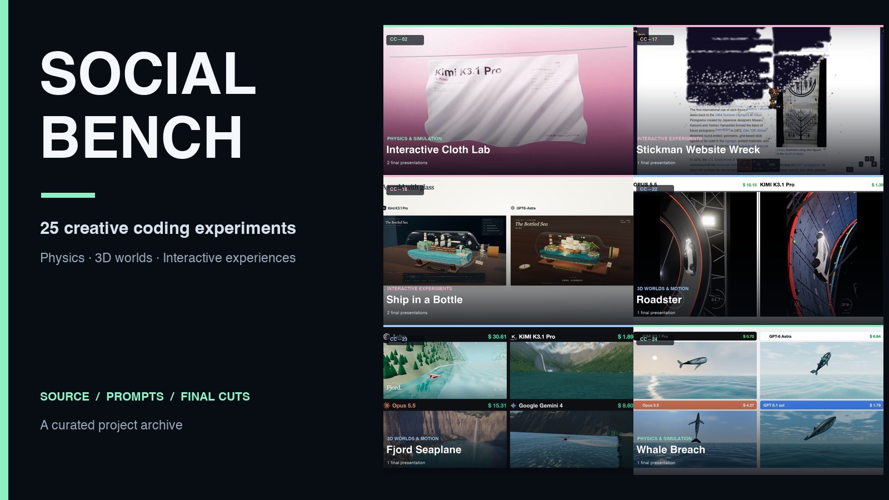
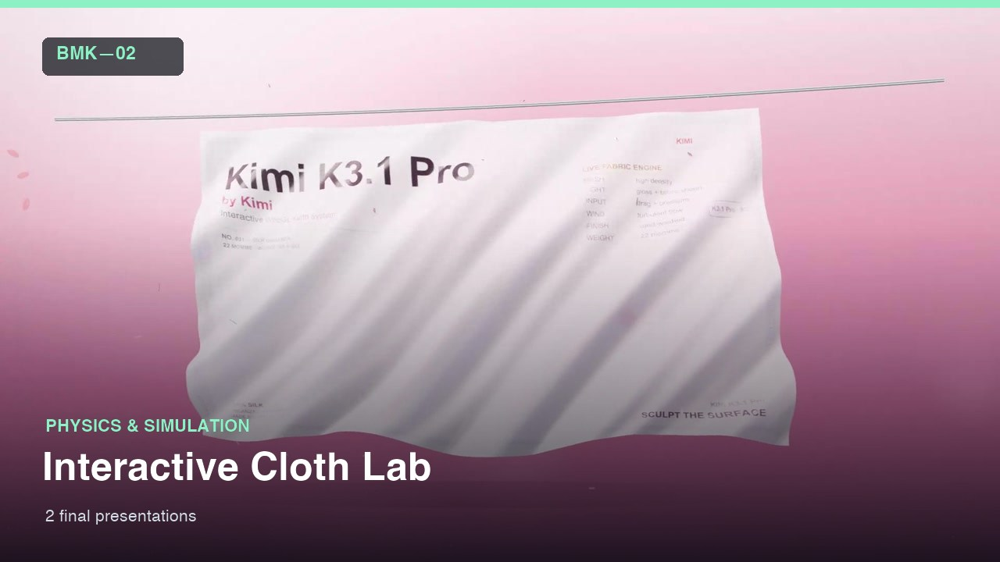
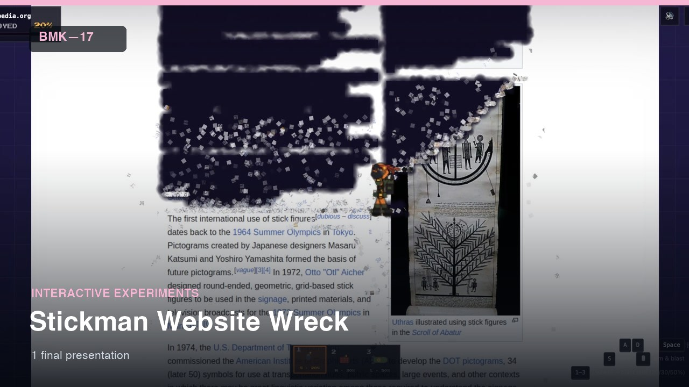
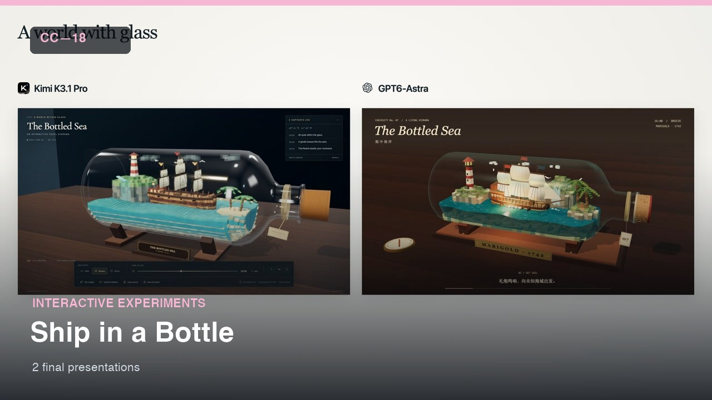
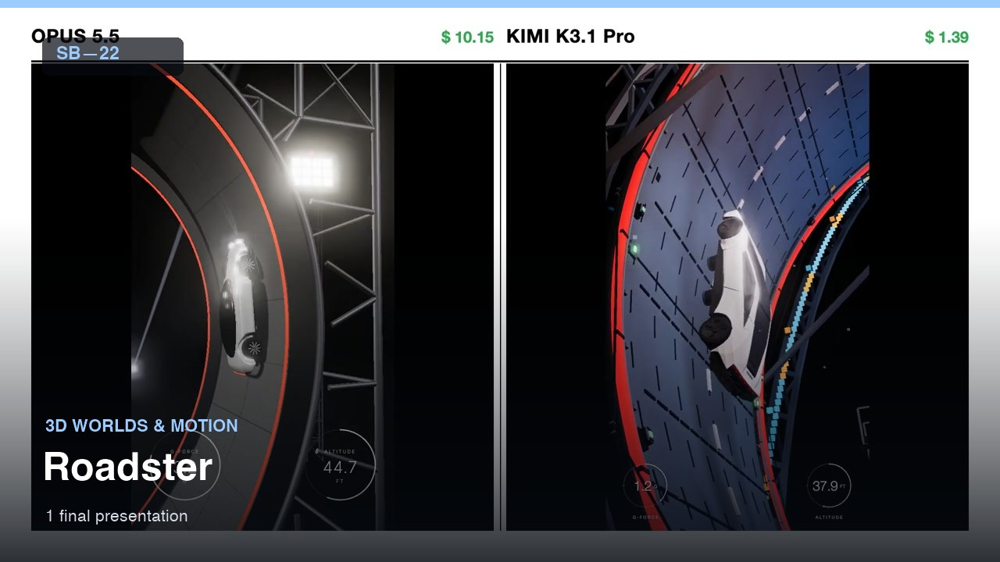
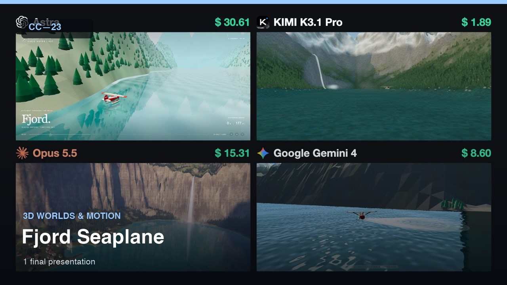
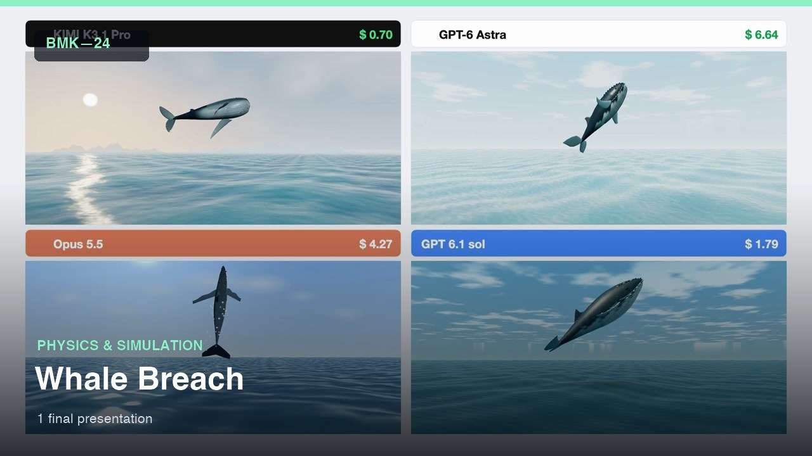

# Social Bench · Creative Coding Archive

A curated collection of **25 physics, 3D and interactive projects**, with **33 final presentation cuts**, verified source material for **8 projects**, and original prompt archives for **15 projects**.

[**Open the interactive gallery →**](https://annieshuyuez22-rgb.github.io/social-bench/)

## Improvement archive

**Not just the final cut — the work behind it.** The [Improvement Archive](PROCESS.md) documents real source versions, technical iterations, before/after captures and prompt refinement, with an explicit evidence standard for every project.

- **5 verified iteration histories:** [Monster Truck](cases/04-vehicle-physics/process.md), [Ship in a Bottle](cases/18-ship-in-a-bottle/process.md), [Fjord Seaplane](cases/23-fjord-seaplane/process.md), [Whale Breach](cases/24-whale-breach/process.md), [Fawn Deer](cases/25-fawn-deer-motion/process.md).
- **7 prompt-evolution pairs:** Basic → Advanced specifications for scope, physics, materials, interaction, camera and accessibility.
- **3 implementation studies:** real code differences and engineering decisions without invented release timelines.
- **10 final-only archives:** no reliable process record, so no intermediate steps are fabricated.

[**Read the complete Improvement Archive →**](PROCESS.md)

## Selected works

<table><tr><td width="50%" valign="top"><a href="cases/02-interactive-cloth-lab/"></a><br><strong>Interactive Cloth Lab</strong><br><sub>A high-density cloth surface with turbulent wind, direct dragging, pressure pulses, and live simulation controls.</sub></td><td width="50%" valign="top"><a href="cases/17-stickman-destroy/"></a><br><strong>Stickman Website Wreck</strong><br><sub>An interactive stickman demolition scene that turns a familiar webpage into a playful destruction sandbox.</sub></td></tr><tr><td width="50%" valign="top"><a href="cases/18-ship-in-a-bottle/"></a><br><strong>Ship in a Bottle</strong><br><sub>Two browser-based interpretations of a miniature sea, with animated waves, a sailing ship, weather, and tactile camera controls.</sub></td><td width="50%" valign="top"><a href="cases/22-roadster-rush/"></a><br><strong>Roadster</strong><br><sub>A driving-game project family spanning an archival comparison cut and a warm low-poly browser recreation.</sub></td></tr><tr><td width="50%" valign="top"><a href="cases/23-fjord-seaplane/"></a><br><strong>Fjord Seaplane</strong><br><sub>A cinematic flight over reflective fjord water, with procedural mountains, waterfalls, spray, and a carefully directed camera.</sub></td><td width="50%" valign="top"><a href="cases/24-whale-breach/"></a><br><strong>Whale Breach</strong><br><sub>A side-view ocean study combining a sculpted whale, layered waves, airborne droplets, and a full breach arc.</sub></td></tr></table>

## Complete archive

| # | Project | Collection | Materials |
|---:|---|---|---|
| 01 | [**Demolition Physics**](cases/01-demolition-physics/) · 拆楼物理 | Physics & Simulation | 1 video · Demo only · Prompt |
| 02 | [**Interactive Cloth Lab**](cases/02-interactive-cloth-lab/) · 布料风场 | Physics & Simulation | 2 videos · Demo only · Prompt |
| 03 | [**Cannon & Brick Wall**](cases/03-cannon-brick-wall/) · 大炮打砖墙 | Physics & Simulation | 1 video · Demo only · Prompt |
| 04 | [**Vehicle Physics Trio**](cases/04-vehicle-physics/) · 小车、火车物理碰撞 | Physics & Simulation | 1 video · Source · Prompt |
| 05 | [**Galton Board**](cases/05-galton-board/) · 粒子碰撞、高尔顿板、方块碰撞 | Physics & Simulation | 1 video · Demo only · Prompt |
| 06 | [**Rocket Launch 3D**](cases/06-rocket-launch/) · 火箭发射 | Physics & Simulation | 1 video · Source · Prompt |
| 07 | [**Roman Colosseum**](cases/07-roman-colosseum/) · 古罗马斗兽场 | 3D Worlds & Motion | 1 video · Demo only · Prompt |
| 08 | [**Pelican Cyclist · SVG**](cases/08-pelican-cyclist-svg/) · 鹈鹕骑自行车 | Interactive Experiments | 4 videos · Demo only · Prompt |
| 09 | [**POS Card Swipe**](cases/09-pos-card-swipe/) · POS 机刷卡 | Interactive Experiments | 1 video · Demo only · Prompt |
| 10 | [**Pelican Cyclist · 3D**](cases/10-pelican-cyclist-3d/) · 3D鹈鹕骑自行车 | 3D Worlds & Motion | 4 videos · Demo only · No public prompt |
| 11 | [**Robot Arm Stacking**](cases/11-robot-arm-stacking/) · Robot arm stacking objects | Physics & Simulation | 1 video · Demo only · No public prompt |
| 12 | [**Drowned City**](cases/12-drowned-city/) · Drowned city of neo-gothic towers | 3D Worlds & Motion | 1 video · Demo only · No public prompt |
| 13 | [**Minecraft Self-Portrait**](cases/13-minecraft-self-portrait/) · Minecraft 搭自画像 | Interactive Experiments | 1 video · Demo only · Prompt |
| 14 | [**Cyclist Motion Study**](cases/14-cyclist-comparison/) · 骑自行车（三模型横测） | 3D Worlds & Motion | 1 video · Demo only · No public prompt |
| 15 | [**Pixel Cheetah**](cases/15-pixel-cheetah/) · 像素画奔跑猎豹 | 3D Worlds & Motion | 1 video · Demo only · Prompt |
| 16 | [**20 Questions · Emoji**](cases/16-emoji-twenty-questions/) · 20 问猜 emoji | Interactive Experiments | 1 video · Demo only · No public prompt |
| 17 | [**Stickman Website Wreck**](cases/17-stickman-destroy/) · 火柴人拆网站 | Interactive Experiments | 1 video · Source · No public prompt |
| 18 | [**Ship in a Bottle**](cases/18-ship-in-a-bottle/) · 瓶中船 | Interactive Experiments | 2 videos · Source · Prompt |
| 19 | [**Pelican Bench · Variant I**](cases/19-pelican-bench-variant-1/) · 鹈鹕骑自行车变体 1 | 3D Worlds & Motion | 1 video · Demo only · No public prompt |
| 20 | [**Pelican Rider · Variant II**](cases/20-pelican-rider-variant-2/) · 鹈鹕骑自行车变体 2 | 3D Worlds & Motion | 1 video · Demo only · No public prompt |
| 21 | [**Bowser Motion Study**](cases/21-bowser-motion-study/) · 马里奥 Bowser | 3D Worlds & Motion | 1 video · Demo only · No public prompt |
| 22 | [**Roadster**](cases/22-roadster-rush/) · Roadster 赛车 | 3D Worlds & Motion | 1 video · Source · No public prompt |
| 23 | [**Fjord Seaplane**](cases/23-fjord-seaplane/) · 峡湾水上飞机 | 3D Worlds & Motion | 1 video · Source · Prompt |
| 24 | [**Whale Breach**](cases/24-whale-breach/) · 鲸鱼跃出水面 | Physics & Simulation | 1 video · Source · Prompt |
| 25 | [**Fawn Deer Motion**](cases/25-fawn-deer-motion/) · 小鹿 | 3D Worlds & Motion | 1 video · Source · Prompt |

## Explore locally

No framework, package install or build step is needed for the gallery:

```bash
git clone https://github.com/annieshuyuez22-rgb/social-bench.git
cd social-bench
python3 -m http.server 8000 --bind 127.0.0.1
```

Open `http://127.0.0.1:8000`. You can search and filter projects, play final cuts, and open individual project pages. Standalone browser apps live under their project's `source/` directory; TypeScript projects retain their manifests and production builds where available.

```text
cases/
  01-demolition-physics/
    README.md          # project notes
    index.html         # gallery detail page
    prompt.md          # included when publicly available
    poster.jpg
    demo.mp4
    source/            # included only for verified source packages
  ...
assets/                # gallery styles, scripts and cover art
data/cases.json        # public project metadata
scripts/build_gallery.py
```

## Archive notes

This is a **creative-coding showcase, not a controlled model benchmark**. It does not make performance, price or ranking claims.

- Historical comparison cuts may include reference or user-provided footage.
- Source is included only where a trustworthy project package could be matched. Missing source is labeled **Demo only**; no look-alike substitute is presented as the original.
- Public reference posts are linked from each project README. Generated recreations are not original-author source code.
- Internal review notes, attachment tokens, private project IDs, operational data and unrelated work files are intentionally excluded.
- Third-party footage, characters and trademarks remain the property of their respective owners. No blanket license is granted for third-party material.

## Rebuild the gallery

```bash
python3 scripts/build_gallery.py
```

The build uses only the Python standard library and the public metadata in `data/cases.json`.
