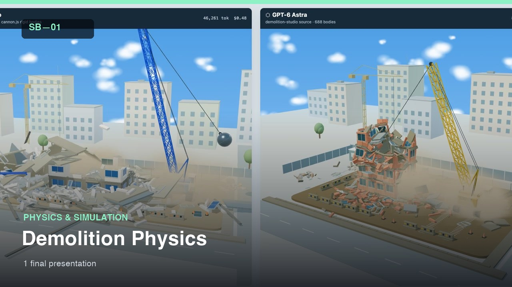

# Demolition Physics · 拆楼物理

A wrecking-ball study with breakable masonry, tumbling debris, impact dust, and persistent rubble.

**Collection:** Physics & Simulation / 物理模拟

**Techniques:** HTML5 Canvas, Rigid-body physics, Particles

## Final presentations

- [Final presentation](demo.mp4)

## Source

No verified source package was found. This entry is preserved as a demo archive without claiming substitute source.

## Prompt archive

[Read the original prompt sections](prompt.md)

## Public reference

https://x.com/atomic_chat_hq/status/2080760629653102958

## Archive note

Archived comparison cuts may include reference or user-provided footage. This is a creative-coding showcase, not a controlled model evaluation. Generated recreations are not original-author source code. Third-party footage, characters and trademarks belong to their respective owners.
