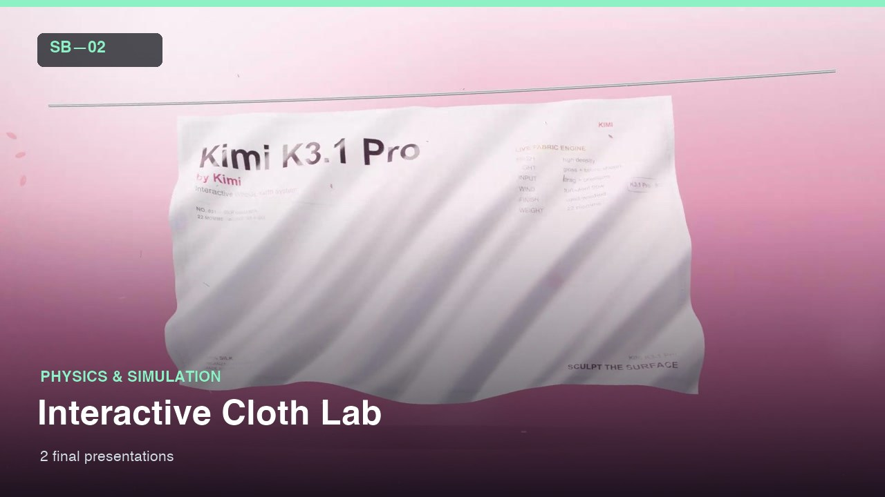

# Interactive Cloth Lab · 布料风场

A high-density cloth surface with turbulent wind, direct dragging, pressure pulses, and live simulation controls.

**Collection:** Physics & Simulation / 物理模拟

**Techniques:** WebGL, Verlet cloth, Wind field

## Final presentations

- [Presentation 1](demo-01.mp4)
- [Presentation 2](demo-02.mp4)

## Source

No verified source package was found. This entry is preserved as a demo archive without claiming substitute source.

## Prompt archive

[Read the original prompt sections](prompt.md)

## Public reference

https://x.com/chetaslua/status/2047393912122486845?s=20

## Archive note

Archived comparison cuts may include reference or user-provided footage. This is a creative-coding showcase, not a controlled model evaluation. Generated recreations are not original-author source code. Third-party footage, characters and trademarks belong to their respective owners.
