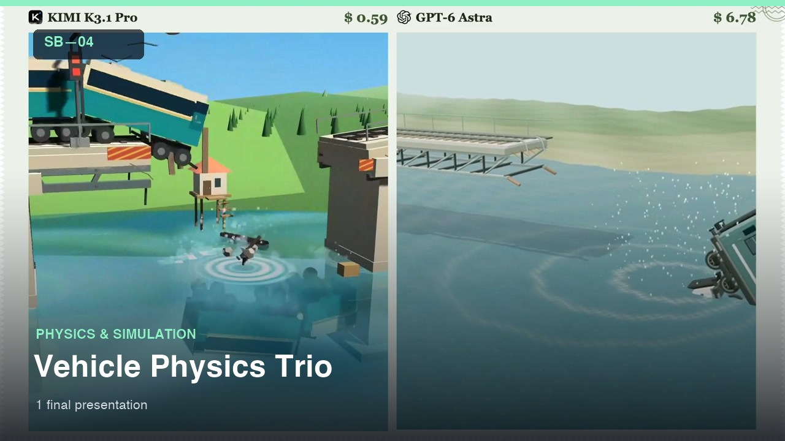

# Vehicle Physics Trio · 小车、火车物理碰撞

A train derailment, a mid-air canyon collision, and a monster-truck crush sequence in three physics studies.

**Collection:** Physics & Simulation / 物理模拟

**Techniques:** Vanilla JavaScript, 2D dynamics, Vehicle physics

## Final presentations

- [Final presentation](demo.mp4)

- [Run Monster Truck](source/monster-truck/index.html)

## Source

Includes the self-contained Monster Truck scene from this three-part study.

[Browse the source package](source.html)

## Prompt archive

[Read the original prompt sections](prompt.md)

## Public reference

https://x.com/atomic_chat_hq/status/2072446067962978411?s=20

## Archive note

Archived comparison cuts may include reference or user-provided footage. This is a creative-coding showcase, not a controlled model evaluation. Generated recreations are not original-author source code. Third-party footage, characters and trademarks belong to their respective owners.
