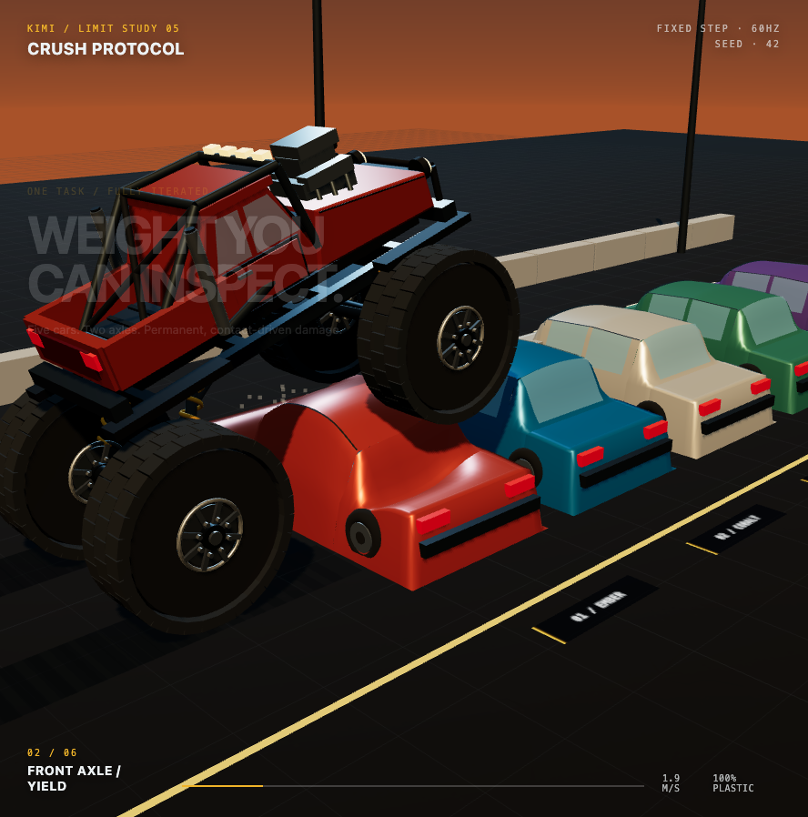
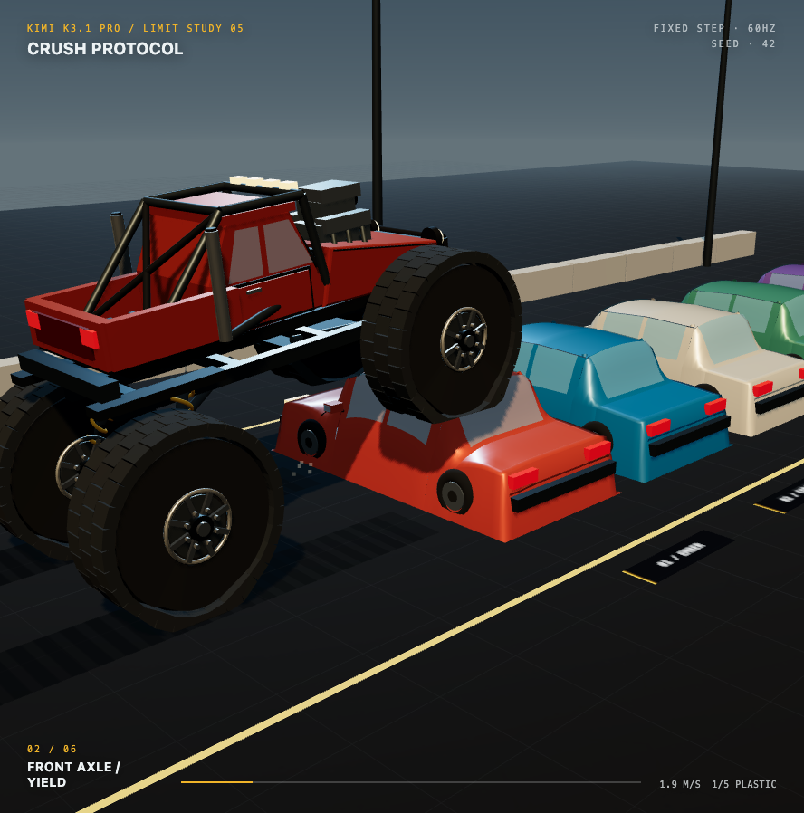
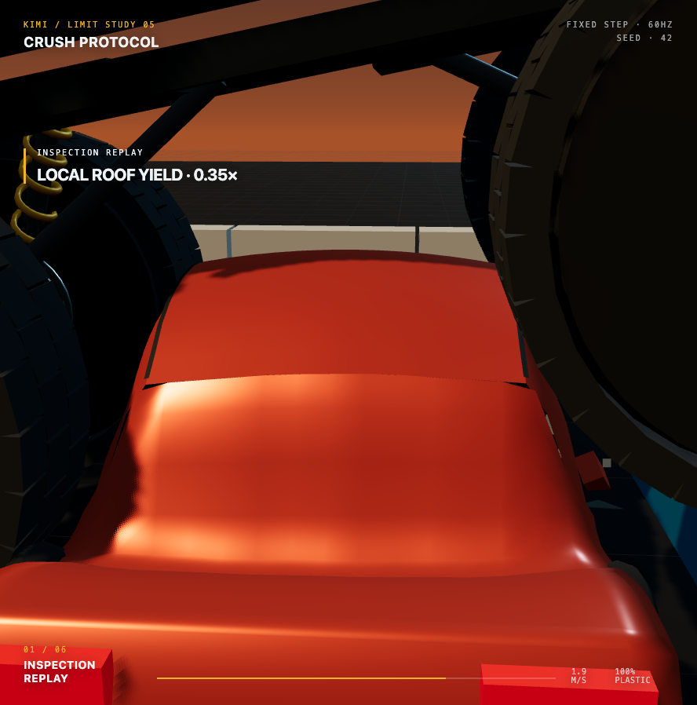
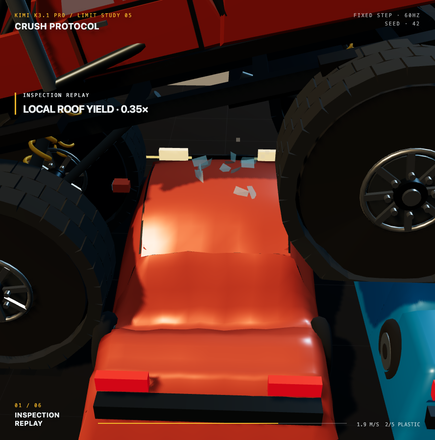

# Vehicle Physics Trio · Improvement archive

**Evidence level:** Verified iteration — Source snapshots, technical logs and/or measurable checks

## Starting point

The initial Monster Truck build already had driving, suspension and procedural vehicle damage. The archive preserves its source and QC captures, followed by a seven-iteration refinement log and a final R7 build.

## What changed

1. **Contact geometry matches the visible car** — Removed a uniform residual ride height and sampled local undeformed body height so the collision surface no longer hovered above the visible contact edge.

2. **Camera and HUD become more readable** — Added a wide wreckage view, corrected slow-motion framing and removed CSS ghosting during timeline jumps. The final composition keeps the truck and five damaged cars legible.

3. **One coherent damage field** — Side, end and roof surfaces now read the same damage field. Local creases, clearcoat and fill light make deformation visible instead of hidden between panels.

4. **Physics and replay correctness** — Damage is driven by actual ground travel and load. Attachments inherit local damage, debris receives approximate vehicle/tire collisions, and duplicate timeline events no longer contaminate deterministic replay.

5. **Resource cleanup across resets** — Replacement vehicles and debris explicitly release GPU resources. Geometry and texture counts remain stable in the final reset test instead of growing per cycle.

6. **R7 tire contact and flattening** — Support sampling increased from 5 to 21 points. Load-dependent tire flattening, sidewall bulging and deformed-geometry contact reports improved the final crush pose.

## Measured details

- 21 support samples per tire (up from 5)
- Geometry count stable at 499 and textures at 8 across the final 30.2-second reset soak
- No browser errors in the final soak report

## Before / after evidence

**Initial contact**

**R7 contact**

The final pass improves ground contact, body alignment and the readability of the crush.

**Initial roof**

**R7 roof**

Shared damage fields and additional geometric refinement make roof deformation more coherent.

## Versions

- [Initial source](versions/initial/src/main.ts) — Initial TypeScript implementation
- [Final source](versions/final/src/main.ts) — Final R7 TypeScript implementation
- [Iteration log](process-evidence/iterations.json) — Seven rounds of implementation notes

## Additional evidence

- [Final soak report](process-evidence/monster-soak.json)

## Evidence boundary

The simulation mixes vehicle dynamics, suspension support and procedural plastic deformation; it is not a full soft-body or node-beam solver. The recorded soak is about 30 seconds and does not prove long-term stability on every device. Not every intermediate source snapshot was retained.
