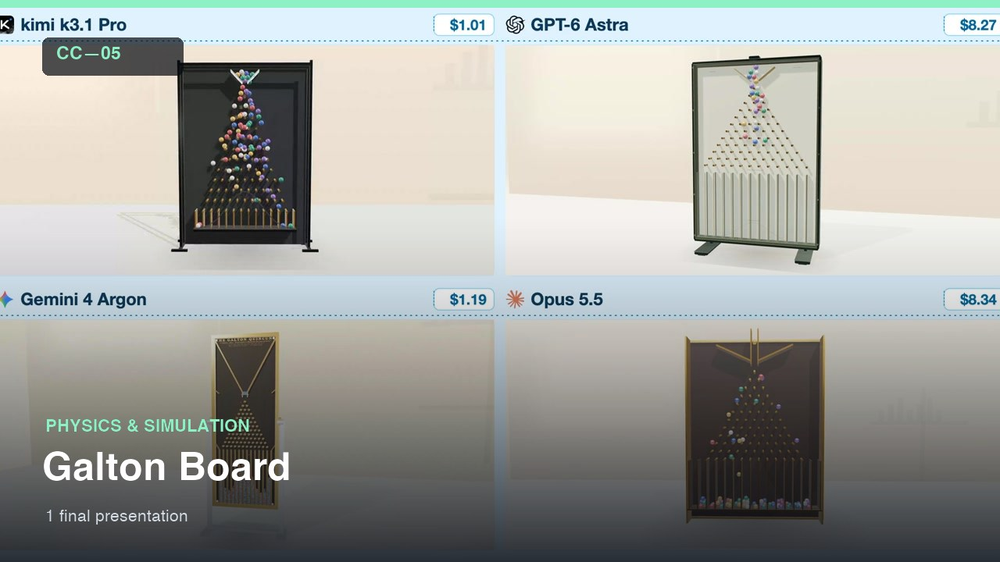

# Galton Board · 粒子碰撞、高尔顿板、方块碰撞

A polished bean machine where a bell-shaped distribution emerges from real ball–peg and ball–ball collisions.

**Collection:** Physics & Simulation / 物理模拟

**Techniques:** HTML5 Canvas, Elastic collisions, Live histogram

## Improvement log

[Read the refinement process, evidence and version history](process.md)

## Final presentations

- [Final presentation](demo.mp4)

## Source

No verified source package was found. This entry is preserved as a demo archive without claiming substitute source.

## Prompt archive

[Read the original prompt sections](prompt.md)

## Public reference

https://x.com/atomic_chat_hq/status/2062676779362357398?s=20

## Archive note

Archived comparison cuts may include reference or user-provided footage. This is a creative-coding showcase, not a controlled model evaluation. Generated recreations are not original-author source code. Third-party footage, characters and trademarks belong to their respective owners.
