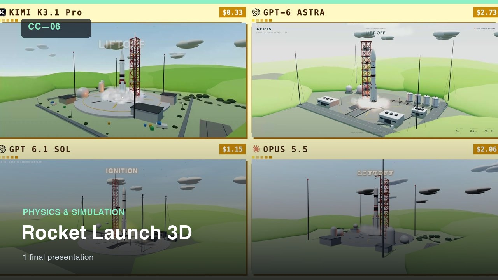

# Rocket Launch 3D · 火箭发射

A procedural launch complex with countdown choreography, ignition, ascent, and interactive camera views.

**Collection:** Physics & Simulation / 物理模拟

**Techniques:** Three.js, Procedural geometry, Camera direction

## Improvement log

[Read the refinement process, evidence and version history](process.md)

## Final presentations

- [Final presentation](demo.mp4)

- [Run Rocket Launch](source/rocket-launch/index.html)

## Source

Includes an earlier self-contained interactive Rocket Launch source variant.

[Browse the source package](source.html)

## Prompt archive

[Read the original prompt sections](prompt.md)

## Public reference

https://x.com/bridgemindai/status/2098381201547419852

## Archive note

Archived comparison cuts may include reference or user-provided footage. This is a creative-coding showcase, not a controlled model evaluation. Generated recreations are not original-author source code. Third-party footage, characters and trademarks belong to their respective owners.
