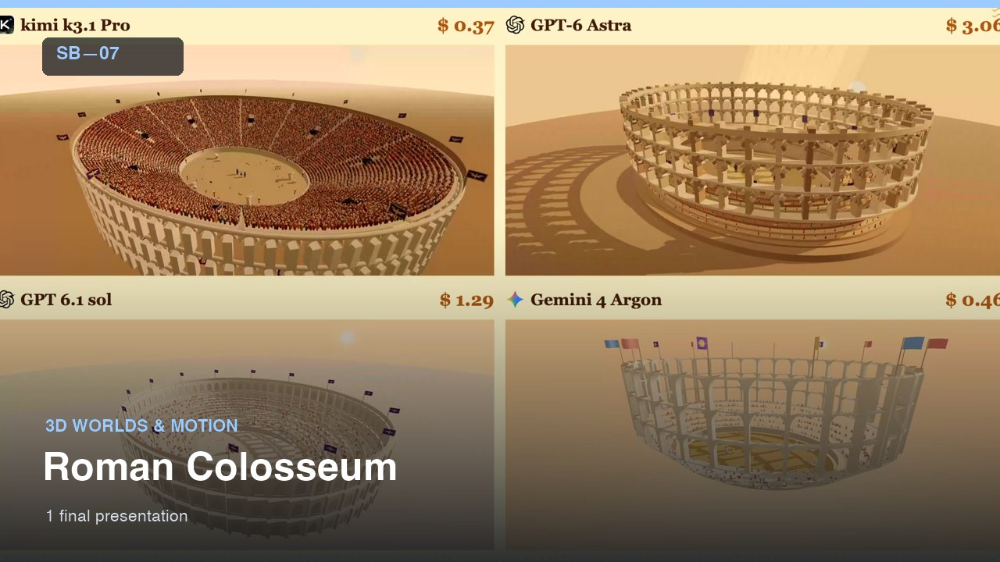

# Roman Colosseum · 古罗马斗兽场

A playable arena scene built around procedural architecture, gladiator motion, and cinematic presentation.

**Collection:** 3D Worlds & Motion / 3D 与动作

**Techniques:** Three.js, Procedural architecture, Game scene

## Final presentations

- [Final presentation](demo.mp4)

## Source

No verified source package was found. This entry is preserved as a demo archive without claiming substitute source.

## Prompt archive

[Read the original prompt sections](prompt.md)

## Public reference

https://x.com/MarioNawfal/status/2088721136787861741?s=20

## Archive note

Archived comparison cuts may include reference or user-provided footage. This is a creative-coding showcase, not a controlled model evaluation. Generated recreations are not original-author source code. Third-party footage, characters and trademarks belong to their respective owners.
