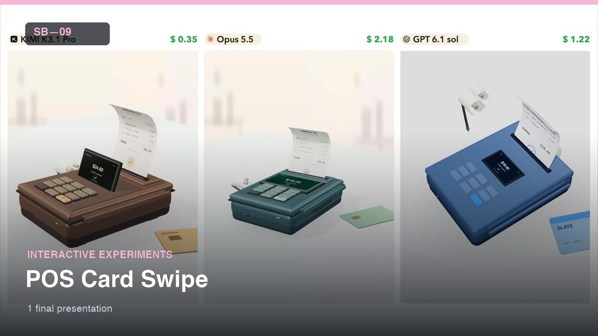

# POS Card Swipe · POS 机刷卡

A minimal isometric payment terminal and a looping bank-card swipe rendered entirely with vector geometry.

**Collection:** Interactive Experiments / 互动实验

**Techniques:** SVG, Isometric design, Loop animation

## Final presentations

- [Final presentation](demo.mp4)

## Source

No verified source package was found. This entry is preserved as a demo archive without claiming substitute source.

## Prompt archive

[Read the original prompt sections](prompt.md)

## Public reference

https://x.com/HarshithLucky3/status/2072634855855448509?s=20

## Archive note

Archived comparison cuts may include reference or user-provided footage. This is a creative-coding showcase, not a controlled model evaluation. Generated recreations are not original-author source code. Third-party footage, characters and trademarks belong to their respective owners.
