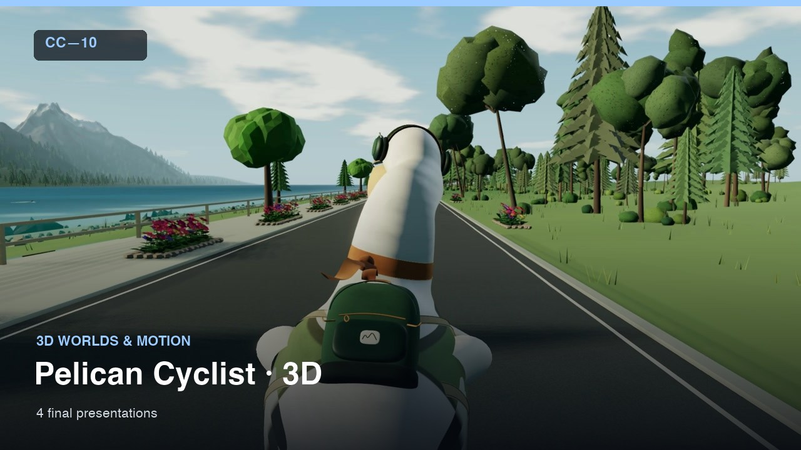

# Pelican Cyclist · 3D · 3D鹈鹕骑自行车

Four three-dimensional takes on the familiar rider, exploring materials, camera motion, and playful secondary movement.

**Collection:** 3D Worlds & Motion / 3D 与动作

**Techniques:** 3D animation, Character motion, Look development

## Improvement log

[Read the refinement process, evidence and version history](process.md)

## Final presentations

- [Presentation 1](demo-01.mp4)
- [Presentation 2](demo-02.mp4)
- [Presentation 3](demo-03.mp4)
- [Presentation 4](demo-04.mp4)

## Source

No verified source package was found. This entry is preserved as a demo archive without claiming substitute source.

## Prompt archive

No public prompt was present in the source record.

## Public reference

https://x.com/gabrielchua/status/2096403701862961161?s=20

## Archive note

Archived comparison cuts may include reference or user-provided footage. This is a creative-coding showcase, not a controlled model evaluation. Generated recreations are not original-author source code. Third-party footage, characters and trademarks belong to their respective owners.
