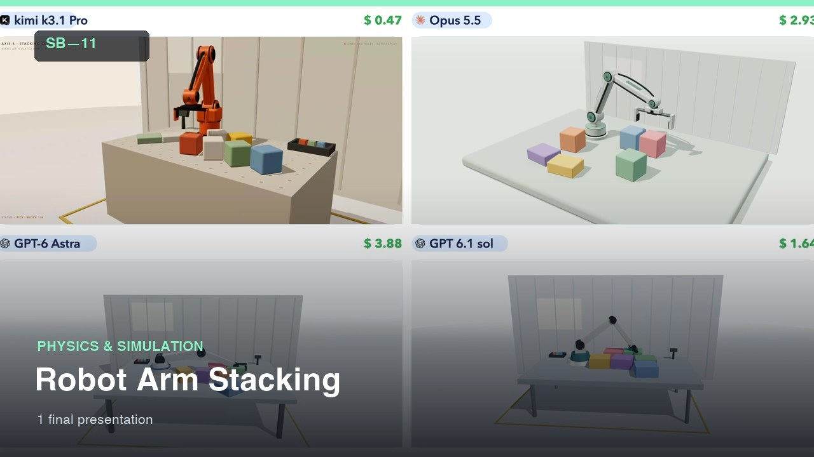

# Robot Arm Stacking · Robot arm stacking objects

A robotic manipulator stacks objects with an emphasis on contact, motion timing, and mechanical readability.

**Collection:** Physics & Simulation / 物理模拟

**Techniques:** 3D motion, Mechanical animation, Object interaction

## Final presentations

- [Final presentation](demo.mp4)

## Source

No verified source package was found. This entry is preserved as a demo archive without claiming substitute source.

## Prompt archive

No public prompt was present in the source record.

## Public reference

https://x.com/diegocabezas01/status/2096205956095127869

## Archive note

Archived comparison cuts may include reference or user-provided footage. This is a creative-coding showcase, not a controlled model evaluation. Generated recreations are not original-author source code. Third-party footage, characters and trademarks belong to their respective owners.
