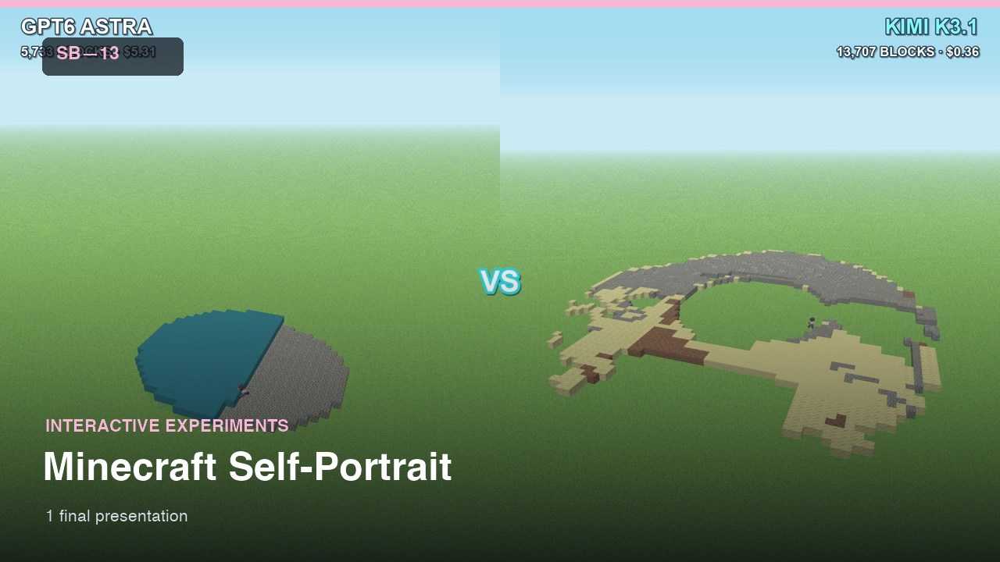

# Minecraft Self-Portrait · Minecraft 搭自画像

A block-built self-portrait exploring how a simple voxel vocabulary can suggest a recognizable character.

**Collection:** Interactive Experiments / 互动实验

**Techniques:** Voxel art, Character design, Minecraft

## Final presentations

- [Final presentation](demo.mp4)

## Source

No verified source package was found. This entry is preserved as a demo archive without claiming substitute source.

## Prompt archive

[Read the original prompt sections](prompt.md)

## Public reference

https://x.com/siyabuilt/status/2104924603126603893?s=20

## Archive note

Archived comparison cuts may include reference or user-provided footage. This is a creative-coding showcase, not a controlled model evaluation. Generated recreations are not original-author source code. Third-party footage, characters and trademarks belong to their respective owners.
