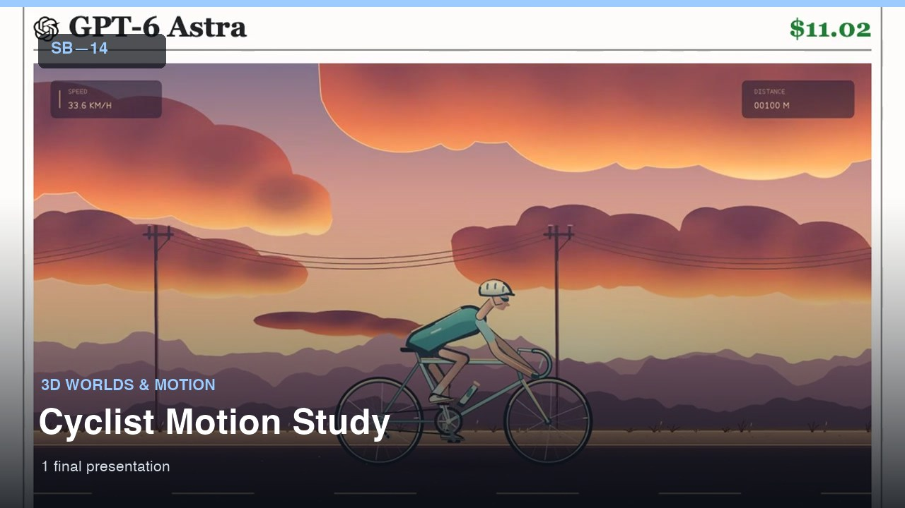

# Cyclist Motion Study · 骑自行车（三模型横测）

An editorial motion study focused on cycling mechanics, framing, and the readability of a repeating action.

**Collection:** 3D Worlds & Motion / 3D 与动作

**Techniques:** Motion design, Editorial layout, Character animation

## Final presentations

- [Final presentation](demo.mp4)

## Source

No verified source package was found. This entry is preserved as a demo archive without claiming substitute source.

## Prompt archive

No public prompt was present in the source record.

## Public reference

https://x.com/AI_Screening/status/2104612559651569851?s=20

## Archive note

Archived comparison cuts may include reference or user-provided footage. This is a creative-coding showcase, not a controlled model evaluation. Generated recreations are not original-author source code. Third-party footage, characters and trademarks belong to their respective owners.
