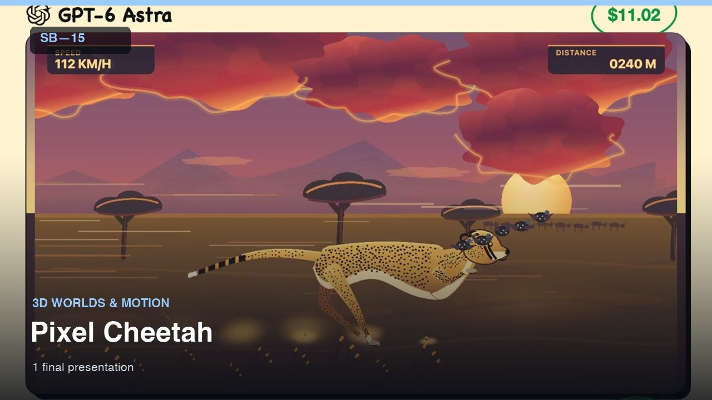

# Pixel Cheetah · 像素画奔跑猎豹

A 640 × 360 pixel-art sprint with attention to gait, silhouette, and the feeling of speed.

**Collection:** 3D Worlds & Motion / 3D 与动作

**Techniques:** Pixel art, Run cycle, Sprite animation

## Improvement log

[Read the refinement process, evidence and version history](process.md)

## Final presentations

- [Final presentation](demo.mp4)

## Source

No verified source package was found. This entry is preserved as a demo archive without claiming substitute source.

## Prompt archive

[Read the original prompt sections](prompt.md)

## Public reference

https://x.com/HarshithLucky3/status/2103120423005425972?s=20

## Archive note

Archived comparison cuts may include reference or user-provided footage. This is a creative-coding showcase, not a controlled model evaluation. Generated recreations are not original-author source code. Third-party footage, characters and trademarks belong to their respective owners.
