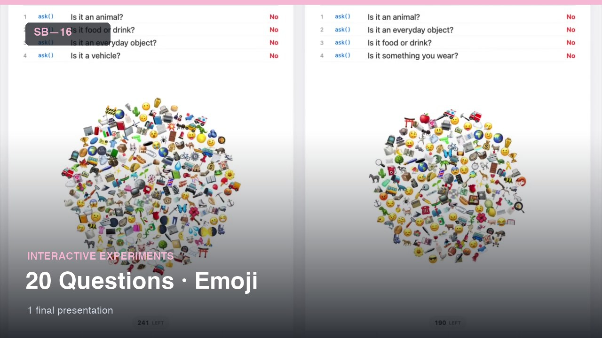

# 20 Questions · Emoji · 20 问猜 emoji

A playful guessing-game experiment built around twenty questions and emoji answers.

**Collection:** Interactive Experiments / 互动实验

**Techniques:** Interactive narrative, Game logic, Emoji

## Final presentations

- [Final presentation](demo.mp4)

## Source

No verified source package was found. This entry is preserved as a demo archive without claiming substitute source.

## Prompt archive

No public prompt was present in the source record.

## Public reference

https://x.com/edwinarbus/status/2104643996123603407?s=20

## Archive note

Archived comparison cuts may include reference or user-provided footage. This is a creative-coding showcase, not a controlled model evaluation. Generated recreations are not original-author source code. Third-party footage, characters and trademarks belong to their respective owners.
