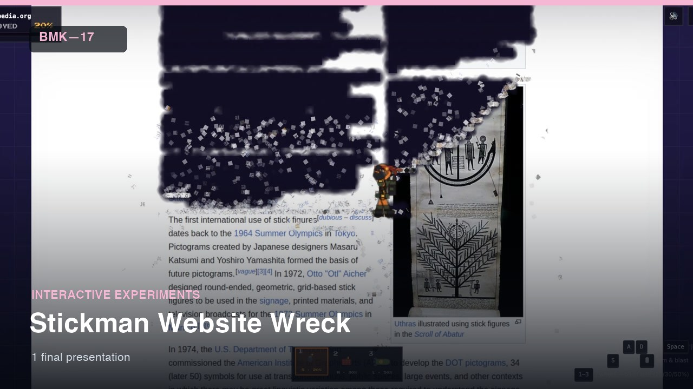

# Stickman Website Wreck · 火柴人拆网站

An interactive stickman demolition scene that turns a familiar webpage into a playful destruction sandbox.

**Collection:** Interactive Experiments / 互动实验

**Techniques:** HTML5 Canvas, Interactive physics, Playful UI

## Improvement log

[Read the refinement process, evidence and version history](process.md)

## Final presentations

- [Final presentation](demo.mp4)

- [Play Stickman Website Wreck](source/stickman-destroy/index.html)

## Source

Includes the browser game source; no build step is required.

[Browse the source package](source.html)

## Prompt archive

No public prompt was present in the source record.

## Public reference

https://x.com/HugoDuprez/status/2104579137575018827?s=20

## Archive note

Archived comparison cuts may include reference or user-provided footage. This is a creative-coding showcase, not a controlled model evaluation. Generated recreations are not original-author source code. Third-party footage, characters and trademarks belong to their respective owners.
