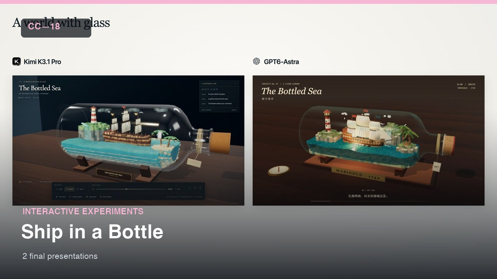

# Ship in a Bottle · 瓶中船

Two browser-based interpretations of a miniature sea, with animated waves, a sailing ship, weather, and tactile camera controls.

**Collection:** Interactive Experiments / 互动实验

**Techniques:** Three.js, Procedural water, Interactive scene

## Improvement log

[Read the refinement process, evidence and version history](process.md)

## Final presentations

- [Presentation 1](demo-01.mp4)
- [Presentation 2](demo-02.mp4)

- [Run S.V. Kestrel](source/sv-kestrel/index.html)
- [Run The Bottled Sea](source/bottled-sea/dist/index.html)

## Source

Includes two browser implementations: S.V. Kestrel and The Bottled Sea (TypeScript source plus production build).

[Browse the source package](source.html)

## Prompt archive

[Read the original prompt sections](prompt.md)

## Public reference

https://x.com/vib3coded/status/2110136719827747181

## Archive note

Archived comparison cuts may include reference or user-provided footage. This is a creative-coding showcase, not a controlled model evaluation. Generated recreations are not original-author source code. Third-party footage, characters and trademarks belong to their respective owners.
