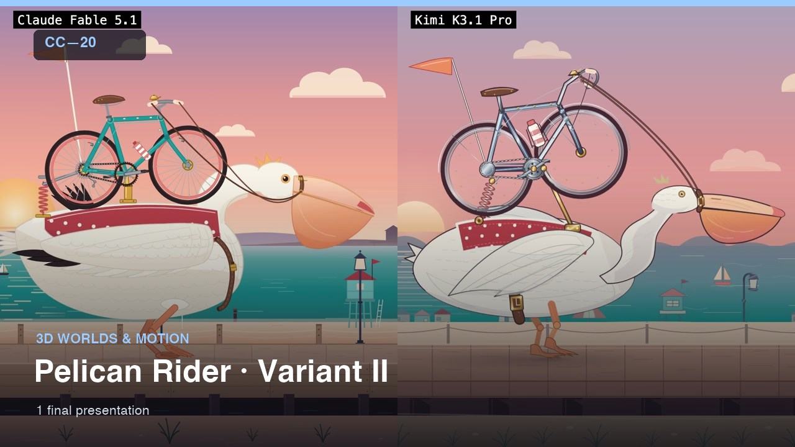

# Pelican Rider · Variant II · 鹈鹕骑自行车变体 2

A second rider variation with alternate geometry, walk-cycle treatment, and presentation.

**Collection:** 3D Worlds & Motion / 3D 与动作

**Techniques:** Motion study, Geometry, Character animation

## Improvement log

[Read the refinement process, evidence and version history](process.md)

## Final presentations

- [Final presentation](demo.mp4)

## Source

No verified source package was found. This entry is preserved as a demo archive without claiming substitute source.

## Prompt archive

No public prompt was present in the source record.

## Public reference

https://x.com/dummerspast39/status/2111519245733654775

## Archive note

Archived comparison cuts may include reference or user-provided footage. This is a creative-coding showcase, not a controlled model evaluation. Generated recreations are not original-author source code. Third-party footage, characters and trademarks belong to their respective owners.
