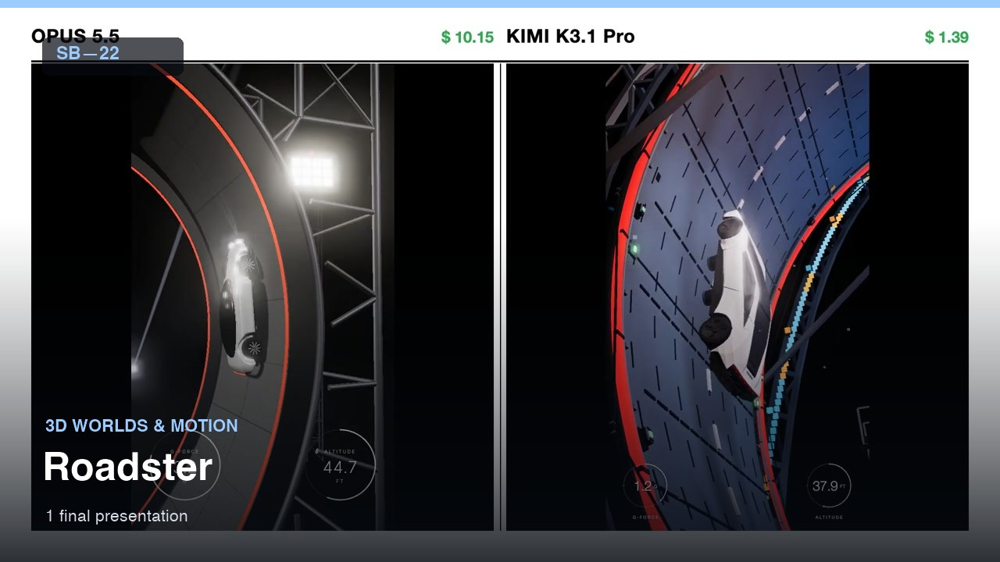

# Roadster · Roadster 赛车

A driving-game project family spanning an archival comparison cut and a warm low-poly browser recreation.

**Collection:** 3D Worlds & Motion / 3D 与动作

**Techniques:** Three.js, Driving controls, Low-poly scene

## Improvement log

[Read the refinement process, evidence and version history](process.md)

## Final presentations

- [Final presentation](demo.mp4)

- [Play Roadster Rush](source/roadster-rush/index.html)

## Source

Includes the separate warm low-poly Roadster Rush browser recreation. Its scene differs from the archived comparison clip.

[Browse the source package](source.html)

## Prompt archive

No public prompt was present in the source record.

## Public reference

https://x.com/atomic_chat_hq/status/2111474429410566422

## Archive note

Archived comparison cuts may include reference or user-provided footage. This is a creative-coding showcase, not a controlled model evaluation. Generated recreations are not original-author source code. Third-party footage, characters and trademarks belong to their respective owners.
