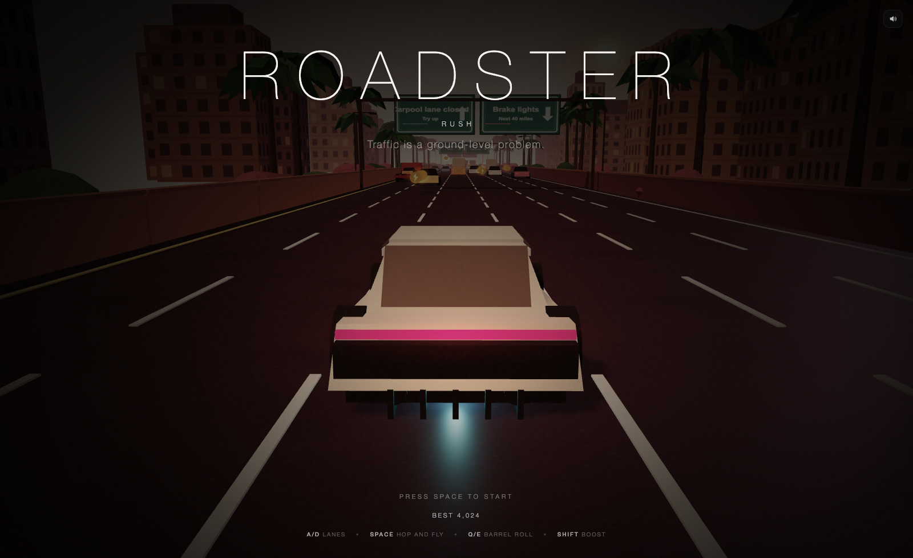
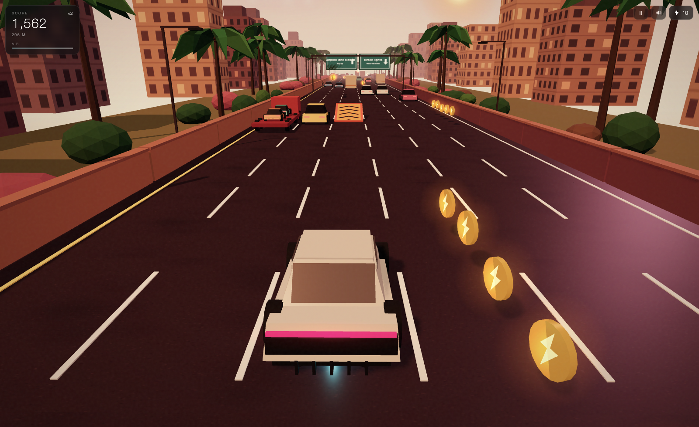

# Roadster · Improvement archive

**Evidence level:** Source study — Current implementation details; no earlier version claimed

## Starting point

The evidence starts with a public reference and ends at the current warm low-poly Roadster Rush implementation. No earlier source or iteration log exists, so this is an implementation walkthrough rather than a fabricated improvement timeline.

## What changed

1. **Reuse and bounded resources** — Road segments loop, while traffic, coin paths and jumps reuse objects. Particles are capped and materials are released on disposal.

2. **Repeatable inspection** — Seeded randomness, ?demo=1 autopilot, scene presets and a small inspection interface make the current build easier to reproduce and review.

3. **Complete game state** — Lane changes, jumping/flight, rolls, acceleration, collisions, scoring, pause and keyboard/touch input form a playable loop.

4. **Lightweight presentation** — Procedural textures and geometry, shared box geometry, a pixel-ratio ceiling, soft shadows and synthesized audio keep the page self-contained.

## Measured details

- No additional quantitative claim is made.

## Before / after evidence

**Title state**

**Gameplay state**

These are two states of the current implementation, not before/after versions.

## Versions

- [Current playable source](source/roadster-rush/index.html) — Current Roadster Rush implementation

## Additional evidence

No additional evidence file is linked.

## Evidence boundary

The Roadster Rush browser implementation is a different visual scene from the archived roadster comparison clip. The original reference is not presented as a model-generated result. No optimization rounds are claimed; these are current implementation details.
