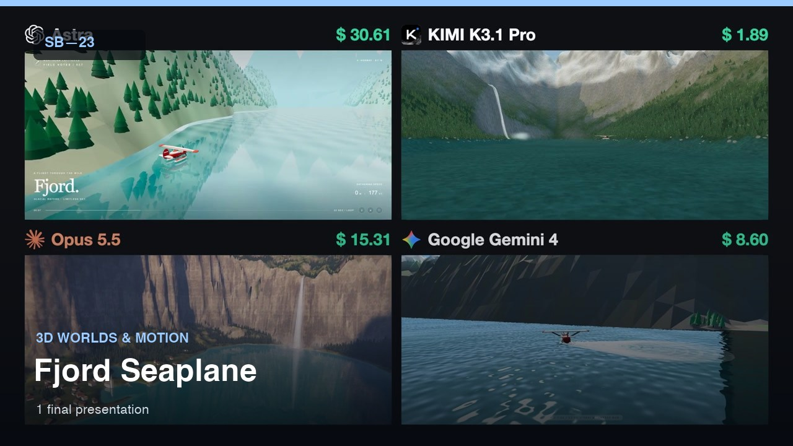

# Fjord Seaplane · 峡湾水上飞机

A cinematic flight over reflective fjord water, with procedural mountains, waterfalls, spray, and a carefully directed camera.

**Collection:** 3D Worlds & Motion / 3D 与动作

**Techniques:** Three.js, Environment art, Camera choreography

## Final presentations

- [Final presentation](demo.mp4)

- [Run Fjord Seaplane](source/fjord-seaplane/index.html)

## Source

Includes the final single-file browser scene used for the seaplane project.

[Browse the source package](source.html)

## Prompt archive

[Read the original prompt sections](prompt.md)

## Public reference

https://x.com/EnvolDev/status/2111175666398048620?s=20

## Archive note

Archived comparison cuts may include reference or user-provided footage. This is a creative-coding showcase, not a controlled model evaluation. Generated recreations are not original-author source code. Third-party footage, characters and trademarks belong to their respective owners.
