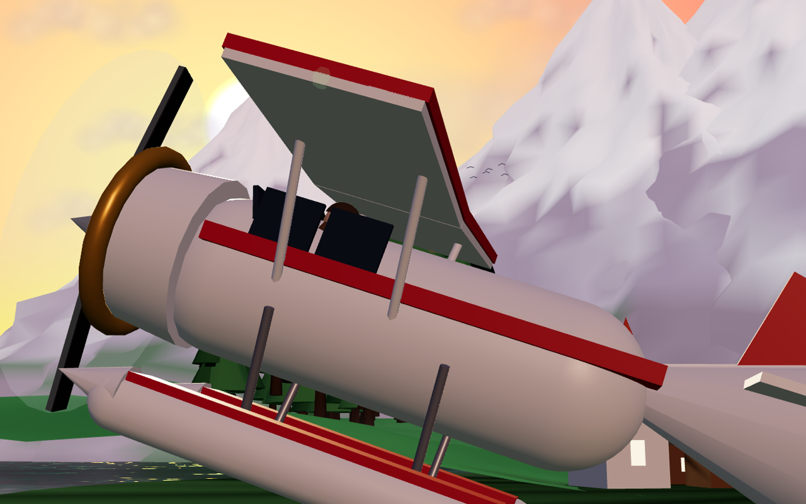
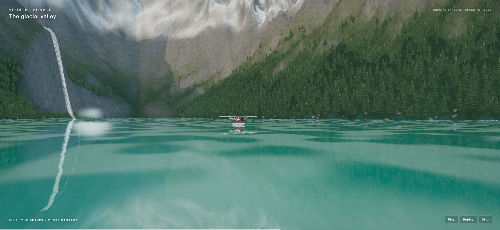

# Fjord Seaplane · Improvement archive

**Evidence level:** Verified iteration — Source snapshots, technical logs and/or measurable checks

## Starting point

The earliest retained Fjord scene is a single-file Three.js seaplane study with mountains, forest, village, waterfalls and a 22-second flight path. It already contains first-pass water and exposure work, so the original one-shot is not claimed.

## What changed

1. **Water and exposure** — A fourth high-frequency ripple layer, sky reflection and glints were added. Exposure increased from 1.28 to 1.35 and hemisphere light from 0.95 to 1.05, with brighter distant haze.

2. **Terrain and reflected color** — Turquoise water, mountain-streak reflections, dual glints and wave shadows were paired with ice fissures, stronger displacement, green slopes and clearer cliff contrast.

3. **Float contact and camera arc** — Aircraft waypoints rose four meters to correct submerged floats. The camera was reorganized into aerial establishment, water-level approach, close flyby and panoramic pull-back.

4. **Reflections and secondary motion** — Planar reflection, wind patches, waterfall-foot rings, foam and subtle camera sway connected the terrain, aircraft and water.

5. **Composition and scale** — The middle shot moved from roughly 24m to 40–46m, then pulled back about 1.35× with a higher angle. Aircraft scale changed from 1.3 to 1.05 to reduce clipping and preserve the mountain frame.

6. **Wake physics and frame-step bug** — A V-wake, takeoff burst, expanding foam and denser spray were added. Frame capture changed from tick(0) to a fixed 1/30 step so particle lifetimes actually advanced.

7. **Two-stage clipping repair** — Cliff-edge vertices first received height variation; the problematic independent cliff pieces were then removed. Waterfalls now follow the same mountain displacement and trees use the makePeak height function while avoiding waterfall channels.

8. **Final implementation and edit rhythm** — The final entry switched to a separate 25-second alpine-lake implementation. Its edit compresses the first 15 seconds to 3, expands the remaining 10 to 16, and holds the final frame for 3 seconds.

## Measured details

- 22-second final comparison timeline
- Fixed 1/30-second frame capture step
- Final aircraft visible from the third second in the edited sequence

## Before / after evidence

**Earlier scene**

**Final implementation**

The final archive capture documents the implementation switch and the cleaner, more open composition.

## Versions

- [Earlier scene source](versions/early/index.html) — Earlier single-file implementation
- [Final scene source](versions/final/index.html) — Final alpine-lake implementation

## Additional evidence

No additional evidence file is linked.

## Evidence boundary

The original one-shot and every intermediate source snapshot were not retained. Most sequence details come from the technical process log. The final alpine-lake entry is a different implementation and must not be credited with every earlier scene modification.
