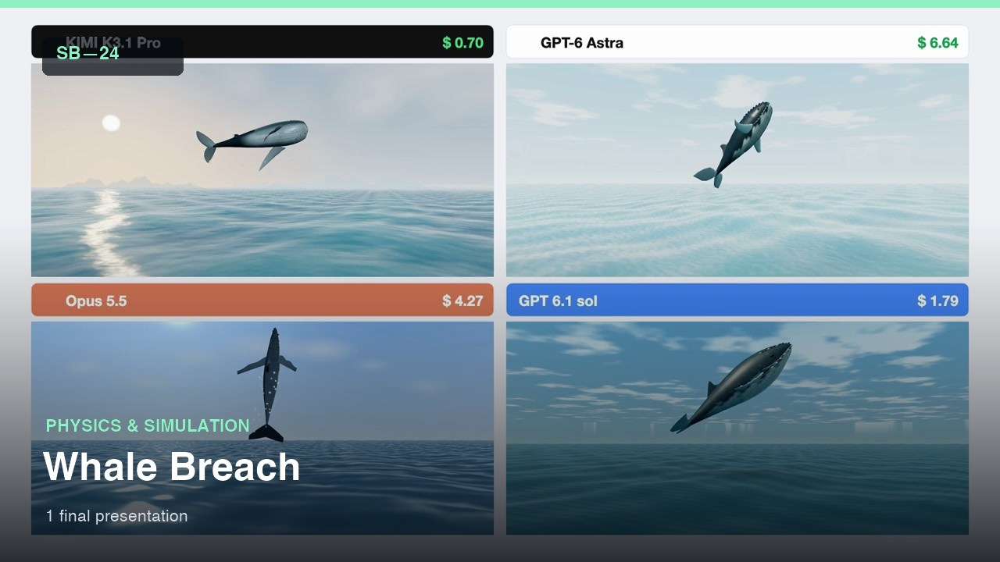

# Whale Breach · 鲸鱼跃出水面

A side-view ocean study combining a sculpted whale, layered waves, airborne droplets, and a full breach arc.

**Collection:** Physics & Simulation / 物理模拟

**Techniques:** Three.js, Blender, Fluid-inspired motion

## Final presentations

- [Final presentation](demo.mp4)

- [Run Whale Breach](source/whale-breach/index.html)

## Source

Includes the single-file Three.js scene and two editable Blender environment files.

[Browse the source package](source.html)

## Prompt archive

[Read the original prompt sections](prompt.md)

## Public reference

https://www.xiaohongshu.com/explore/6ad758f8000000002701f44f?xsec_token=CBCgH2-WLW8AlUubX76kZ5gz2KKEoQnQZ5jXM5s9iOicc=&xsec_source=app_share

## Archive note

Archived comparison cuts may include reference or user-provided footage. This is a creative-coding showcase, not a controlled model evaluation. Generated recreations are not original-author source code. Third-party footage, characters and trademarks belong to their respective owners.
