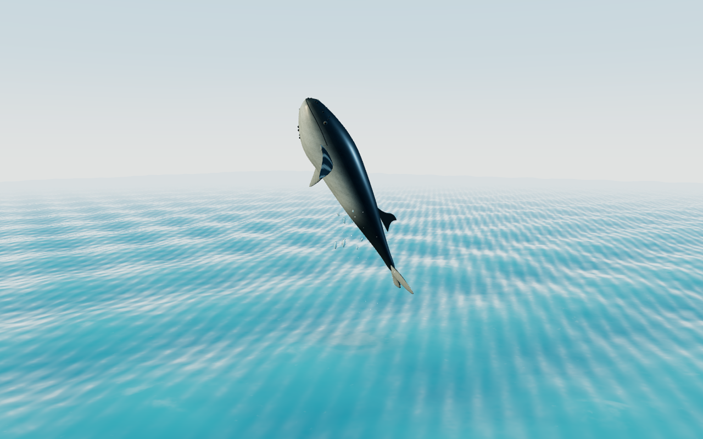
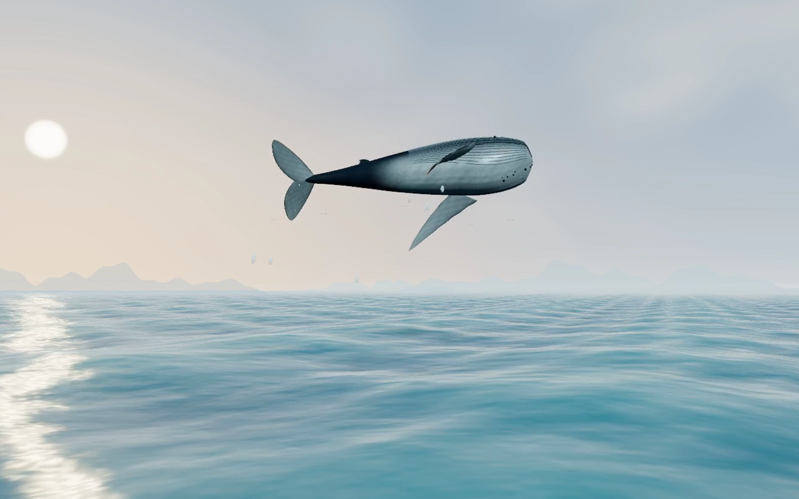
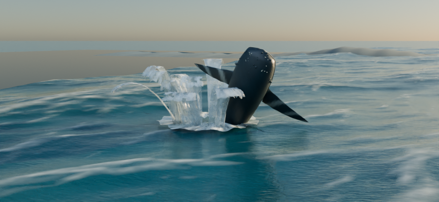
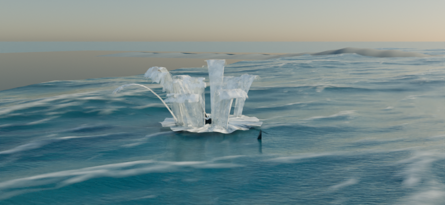

# Whale Breach · Improvement archive

**Evidence level:** Verified iteration — Source snapshots, technical logs and/or measurable checks

## Starting point

The retained one-shot already had custom whale cross-sections, long pectoral fins, flukes, throat pleats, procedural ocean, broken water crowns and gravity droplets. Later work split into a Blender asset branch and an 11-second lateral Three.js branch.

## What changed

1. **Breach orientation** — Pitch, yaw and roll keys were refined so the whale reads as a lateral breach rather than a rigid vertical pose.

2. **Blender ocean and distant water** — Regular wave stripes were replaced by multi-scale geometric waves and stretched noise. A distant-ocean ring and matched materials reduced visible tiling and the far-water seam.

3. **Procedural spray and foam** — Broken thin sheets, expanding foam rings and 2,450 Geometry Nodes emission points created gravity-driven droplets with irregular edges.

4. **Verified asset orientation** — The existing procedural whale was imported into Blender as 66 meshes and 17,992 triangles. Native −Y and side views were rendered before applying Z=-90°, avoiding guessed orientation.

5. **Material and water-entry corrections** — Micro-noise bump, revised roughness and coating improved the skin. A rectangular deep-water volume caused a dark band and was disabled while preserving geometric waves and IOR. All 244 affected water-entry frames were rerendered.

6. **An 11-second lateral choreography** — The Three.js branch uses a fixed low camera and an 11-second action rather than a simple speed-up. The whale travels 23.4m, about 1.857 body lengths, with head contact at 5.667 seconds.

7. **Surface, anatomy and spray finishing** — Five Gerstner-style wave groups, 19 geometric throat pleats, asymmetric swept fins, low sun, islands and birds were combined with separated droplets, mist, broken sheets and uneven foam.

## Measured details

- Lateral source: 660 frames at 60fps, 11 seconds
- Blender branch: 528 rendered frames at 24fps, 22 seconds
- 244 water-entry frames rerendered
- 23.4m lateral travel; apex at 4.5s

## Before / after evidence

**One-shot**

**Lateral refinement**

The lateral branch replaces the narrow vertical read with a clearer body silhouette, longer travel and calmer ocean composition.

**Original water entry**

**Corrected water entry**

The Blender branch continues pitch beyond vertical and lowers the body for a more convincing entry.

## Versions

- [One-shot source](versions/one-shot/index.html) — Retained initial browser implementation
- [Orientation-refined source](versions/refined/index.html) — Pitch/yaw/roll refinement
- [11-second lateral source](versions/lateral/index.html) — Final lateral choreography

## Additional evidence

- [Lateral motion audit](process-evidence/whale-motion-audit.json)

## Evidence boundary

The five self-refinement rounds do not have individual source snapshots. Blender asset work and the lateral Three.js version are parallel branches, not one linear stack. The archive presents the lateral branch as its final browser scene and keeps the Blender evidence separate.
