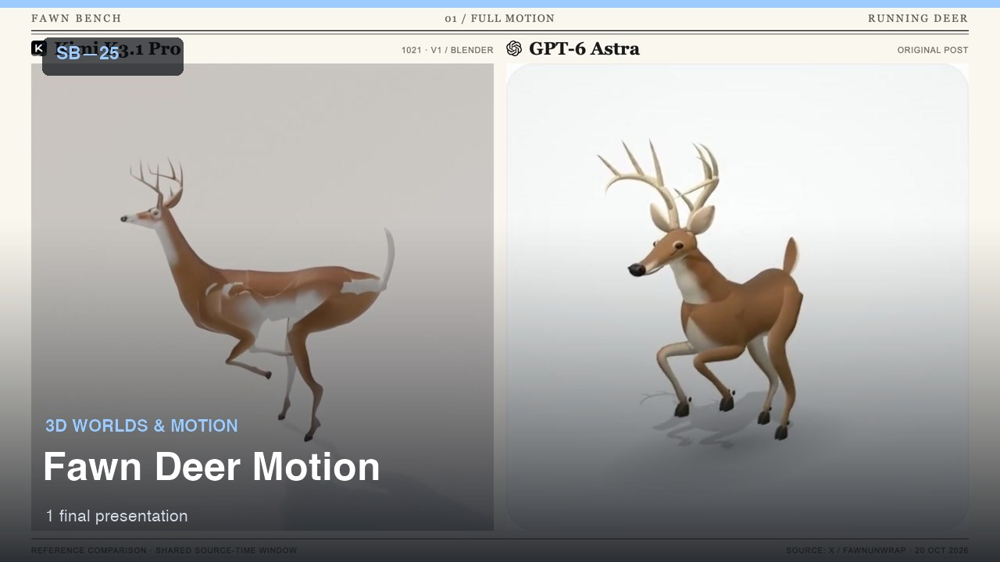

# Fawn Deer Motion · 小鹿

A white-tailed deer study refined through model assets, gait analysis, material work, and side-view cinematography.

**Collection:** 3D Worlds & Motion / 3D 与动作

**Techniques:** Blender, EEVEE, Gait refinement

## Final presentations

- [Final presentation](demo.mp4)

## Source

Includes editable Blender/GLB assets and scene-refinement utilities; no browser app is claimed.

[Browse the source package](source.html)

## Prompt archive

[Read the original prompt sections](prompt.md)

## Public reference

https://x.com/fawnunwrap/status/2112294137638666401

## Archive note

Archived comparison cuts may include reference or user-provided footage. This is a creative-coding showcase, not a controlled model evaluation. Generated recreations are not original-author source code. Third-party footage, characters and trademarks belong to their respective owners.
