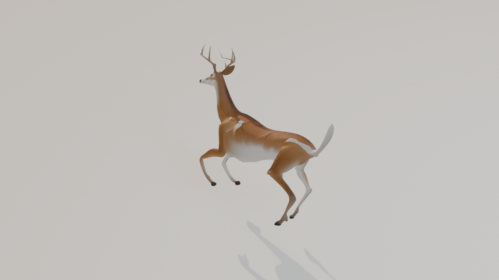
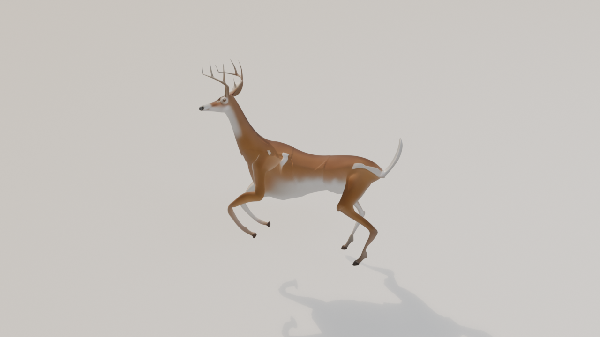

# Fawn Deer Motion · Improvement archive

**Evidence level:** Verified iteration — Source snapshots, technical logs and/or measurable checks

## Starting point

The starting point was an existing Blender asset: 49,714 vertices, 14 bones, 65 frames at 24fps, a 50mm camera and original animation. This project refined that asset; it did not remodel the deer or claim a new gait.

## What changed

1. **Asset integrity and portability** — The original mesh, rig and action were preserved without retopology. Three external textures were packed into the final Blender file and verified after reopening.

2. **Orientation and camera alignment** — Whole-model yaw and pitch were aligned to zero while retaining the 50mm lens and original camera translation.

3. **Systematic light search** — Thirty key-light directions and five sun angles were evaluated on frame 13. The selected (0.35, 0.4, -0.8) direction and 0.12rad sun angle brought shadow direction and length closer to the reference.

4. **Short-fur material refinement** — Scale-220 fine noise, Bump strength 0.12 at distance 0.002, Sheen 0.06 and Specular 0.45 created a restrained short-fur surface without a plastic highlight.

5. **Occlusion, shadows and anti-aliasing** — GTAO was enabled at distance 0.35 and quality 1.0. EEVEE samples increased from 64 to 256, shadow rays from 1 to 4 and shadow steps from 6 to 8.

6. **Honest motion presentation** — The original 16-frame gait and camera motion were retained. Because the direct loop seam was visible, the deliverables became a 65-frame source-length cut and a 16-second motion-compensated slow-motion cut instead of a claimed seamless loop.

## Measured details

- Bounding-box edges differ by 0–1px on five checked frames
- 49,714 vertices and 14 bones preserved
- 65 source frames at 24fps; 384-frame interpolated slow-motion cut
- 256 EEVEE samples, 4 shadow rays, 8 shadow steps

## Before / after evidence

**Baseline · frame 13**

**Refined · frame 13**

Orientation, light direction, short-fur shading and shadow settings were refined while preserving the original asset and animation.

## Versions

- [Original Blender asset](source/blender/deer_scene-original.blend) — Original scene
- [Refined Blender asset](source/blender/1021-小鹿-v1.blend) — Packed textures and final refinements

## Additional evidence

- [Public verification summary](process-evidence/deer-verification.json)

## Evidence boundary

The 0–1 pixel result refers only to bounding-box edges on five representative frames, not complete visual equivalence. The 16-second cut uses bidirectional motion-compensated interpolation, not 384 newly rendered frames or a newly authored 16-second gait. The public reference is not a controlled regeneration comparison.
